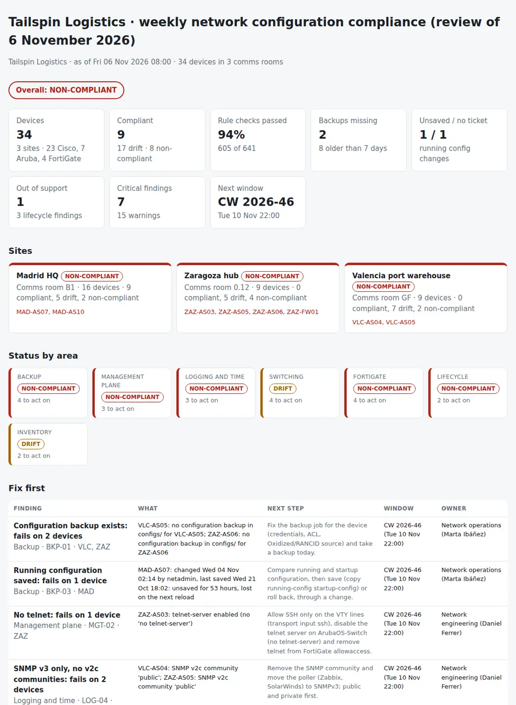

# Network Configuration Compliance Review

The weekly review of the network in the comms rooms: does every switch, router and firewall match the baseline, is its configuration backed up and saved, is it running an approved version, and what do we fix in the next change window? From the configuration backups (Cisco IOS and IOS-XE, HPE Aruba ArubaOS-Switch, FortiGate FortiOS), the comms-room inventory exported from Device42, the baseline and the approved changes, it puts together:

- **Backups:** devices with no backup, backups older than a week, running configurations changed after the last save, and changes made with no approved change ticket.
- **Management plane:** SSH v2 only, no telnet, `enable secret` and `service password-encryption`, AAA with TACACS+ or RADIUS and a local fallback, a login banner, an idle timeout and management access restricted to the management network.
- **Logging and time:** NTP servers and syslog hosts as baseline, the time zone, and SNMP v3 only, with `public` and `private` communities flagged as critical.
- **Switching hygiene:** unused ports shut down in the parking VLAN, PortFast and BPDU guard on user ports, no native VLAN 1 on trunks, no user ports in VLAN 1, port security where the baseline asks for it.
- **FortiGate:** admin access on WAN interfaces, accept policies from `all` to `all` with service `ALL`, accept policies without logging, disabled policies kept for months, firmware below the baseline.
- **Lifecycle and inventory:** OS versions not approved for the model, end of support passed or close, backups with no inventory row, model or serial different from the inventory.

A folder of backups, two CSVs, one JSON with the golden rules and one Python command give every device a status (**COMPLIANT**, **DRIFT** or **NON-COMPLIANT**), every site and the review an overall status, and the pack for the change board with a proposed change window for every finding: **what is out of baseline, where, how bad, and in which window it gets fixed.**

Python 3.10+, standard library only. It runs with fictional demo data out of the box. A read-only PowerShell collector (Posh-SSH) is included, and Oxidized or RANCID backups work as they are.

The end-of-support dates come from the same Device42 export that [38-it-asset-lifecycle-planner](https://github.com/inigogonzalezgarcia/38-it-asset-lifecycle-planner) turns into a refresh plan; the FortiGate checks are the weekly hygiene next to the segmentation review of [26-ot-segmentation-lab](https://github.com/inigogonzalezgarcia/26-ot-segmentation-lab).



## Why

Network configurations drift one night change at a time. In a typical week across three comms rooms:

- a branch switch still accepts telnet because it was installed from an old template;
- two devices answer SNMP with the community `public`, one because nobody removed the factory default;
- the switches of one site still point NTP to a server that was switched off, so their logs disagree with everyone else's by minutes;
- a FortiGate has HTTPS and SSH admin open on its WAN interface and an accept policy from all to all with service ALL and logging off, left from a cutover two months ago;
- an access switch was changed at two in the morning, with no ticket, and the change was never saved, so the next power cut takes it away;
- two devices have no backup at all and a whole site's backups are ten days old since a firewall rule change broke the backup job;
- six unused ports on a Madrid access switch are up, in VLAN 1;
- a router runs an IOS-XE release that is not on the approved list;
- and an access switch went out of vendor support five years ago and is still in the rack.

Each of these is visible in one place: the backup, the inventory or the change calendar. The review joins them by hostname, applies the same rules to every device and every week, and gives the change board one list. The rules are in `baseline.json`, `settings.json` and `netcompliance/checks.py`.

## What it checks

| Area | Code | Finding |
|---|---|---|
| Backup | BKP-01 | Inventory devices with no backup in `configs/` (critical) |
| Backup | BKP-02 | Backups older than `backup_max_days` (critical after `backup_critical_days`) |
| Backup | BKP-03 | Cisco running configuration changed after `NVRAM config last updated` (critical after `unsaved_critical_hours`) |
| Backup | BKP-04 | Cisco `Last configuration change` this week outside an approved change in `changes.csv` |
| Management plane | MGT-01 | No `ip ssh version 2` |
| Management plane | MGT-02 | Telnet allowed: VTY `transport input telnet` or `all`, no `no telnet-server` on ArubaOS-Switch, telnet in FortiGate `allowaccess` (critical); `transport input` not set (warning) |
| Management plane | MGT-03 | `enable password`, no `enable secret`, no `service password-encryption` |
| Management plane | MGT-04 | Login not through a TACACS+ or RADIUS group with `local` as fallback |
| Management plane | MGT-05 | No login banner |
| Management plane | MGT-06 | Idle timeout over `max_idle_minutes` or never (VTY `exec-timeout`, `console idle-timeout`, `admintimeout`) |
| Management plane | MGT-07 | VTY lines without `access-class`, no `ip authorized-managers`, FortiGate admins without trusted hosts |
| Logging and time | LOG-01 | NTP servers missing from the baseline or not in it |
| Logging and time | LOG-02 | Baseline syslog hosts missing |
| Logging and time | LOG-03 | Time zone different from the baseline |
| Logging and time | LOG-04 | SNMP v2c communities: critical for `public` and `private`, a warning for any other |
| Switching | SWI-01 | Unused access ports (no description) not shut down in `parking_vlan` |
| Switching | SWI-02 | User ports without PortFast and BPDU guard (`admin-edge-port` and `bpdu-protection` on ArubaOS-Switch) |
| Switching | SWI-03 | Trunks with native VLAN 1 or other than `native_vlan` |
| Switching | SWI-04 | User ports in VLAN 1 |
| Switching | SWI-05 | User ports without port security at the `port_security_sites` |
| FortiGate | FWL-01 | HTTPS, HTTP, SSH or telnet admin access on a WAN interface (critical) |
| FortiGate | FWL-02 | Accept policies with `srcaddr all`, `dstaddr all` and `service ALL` (critical) |
| FortiGate | FWL-03 | Accept policies with `logtraffic disable` |
| FortiGate | FWL-04 | Policies disabled for more than `disabled_policy_days` (the date in their comments) |
| FortiGate | FWL-05 | FortiOS below `min_firmware` for the model |
| Lifecycle | LCM-01 | OS version not in `approved_versions` for the model family |
| Lifecycle | LCM-02 | End of support passed (critical) or within `eos_warning_days` |
| Inventory | INV-01 | Backups with no inventory row |
| Inventory | INV-02 | Hostname, model or serial in the backup different from the inventory |

Every rule gives every device *pass*, *fail* or *n/a*. A device is NON-COMPLIANT with a critical failure, DRIFT with warnings only, COMPLIANT otherwise; a site and the review take the worst status of their devices. Critical findings are proposed for the first change window in `settings.json`, warnings for the next one.

## Outputs

| File | What |
|---|---|
| `report.html` | Overall status, tiles (devices, compliant, rule checks passed, backups missing, unsaved changes, out of support, critical findings, next window), a card per site, status by area, "Fix first", a grid of devices by area, backups and changes, management plane, logging, switching, FortiGate, lifecycle and inventory, and all findings |
| `compliance-pack.md` | The pack for the change board: a decisions table with the proposed window and a decision column per finding, headlines, scope and evidence, status by site, devices not compliant, backups and changes, lifecycle, findings, exceptions, notes and sign-off |
| `device-status.csv` | Every device with its site, room, rack, role, model, platform, status, findings and proposed window |
| `rule-results.csv` | Every rule for every device: pass, fail or n/a, with the severity and the detail; the evidence for audits |
| `backups.csv` | Every device with its backup file and age, last change and who made it, last save, unsaved changes and the change ticket that covers it |
| `lifecycle.csv` | Every device with its model family, OS version, approved versions, end of support and days left |
| `actions.csv`, `findings.csv` | The findings with owner, sites, devices and change window, and columns for the change ticket and the decision |

## Try it

```bash
git clone https://github.com/inigogonzalezgarcia/45-network-config-compliance.git
cd 45-network-config-compliance
python -m netcompliance demo
```

Open `output/report.html` and `output/compliance-pack.md`.

### The demo data

The demo is a made-up logistics company, Tailspin Logistics, reviewed on Friday 6 November 2026, with three comms rooms:

- **Madrid HQ:** two Catalyst 9300-24T core switches, nine Catalyst 9300-48P access switches and an old Catalyst 3750-X, two ISR 4331 routers and a FortiGate 100F HA pair;
- **Zaragoza hub:** seven HPE Aruba 2930F switches, an ISR 4331 and a FortiGate 60F;
- **Valencia port warehouse:** a Catalyst 9300-24T core, five Catalyst 9200-48P access switches, an ISR 4331 and a FortiGate 60F.

33 devices in the inventory, 32 backups (31 of them for inventory devices), four change tickets, the baseline and two change windows. Everything is fictional: hostnames, serials, people and tickets; addresses are private or from the documentation ranges, and the approved versions are the made-up company's choice, not vendor advice. The problems are placed on purpose among the everyday ones:

- **Backups:** no backup for ZAZ-AS06 and VLC-AS05; every Zaragoza backup ten days old; MAD-AS07 changed on Wednesday at 02:14 with no ticket and not saved for 53 hours.
- **Management plane:** telnet still on at ZAZ-AS03; the 3750-X without `ip ssh version 2`; one Aruba switch with no console idle timeout.
- **Logging:** SNMP community `public` on VLC-AS04 and ZAZ-AS05 (the ArubaOS-Switch default nobody removed); five Valencia switches pointing NTP to a server that no longer exists; a v2c community on a Madrid router.
- **Switching:** six unused ports up in VLAN 1 on MAD-AS04; two user ports without BPDU guard; a Valencia uplink with native VLAN 1; two ports without port security in Madrid.
- **FortiGate:** ZAZ-FW01 with HTTPS and SSH admin on wan1 and a temporary all/all/ALL accept policy with logging off since a cutover in September; a policy disabled in April still in Valencia.
- **Lifecycle and inventory:** VLC-RT01 on IOS-XE 17.6.5, not approved; MAD-AS10, a Catalyst 3750-X past its last date of support (31 October 2021); a switch swapped under RMA with the old serial in Device42; a Valencia switch backed up but never added to Device42.

The result: 34 devices, **9 compliant, 17 drift and 8 non-compliant**, 94% of 641 rule checks passing, 7 critical findings and 15 warnings, every site and the review **NON-COMPLIANT**.

## Use it with your own data

1. Collect the configurations (read-only), or use the folder Oxidized or RANCID already keeps:
   ```powershell
   Install-Module Posh-SSH -Scope CurrentUser
   .\scripts\Get-NetworkConfigBackup.ps1 -InventoryCsv .\data\inventory.csv -OutputFolder .\data
   ```
   It connects with `New-SSHSession`, turns paging off for the session and runs only `show running-config` (Cisco, ArubaOS-Switch, through `New-SSHShellStream`) or `show full-configuration` (FortiGate, through `Invoke-SSHCommand`), and saves `configs/<hostname>.cfg` and `backup_log.csv`. Credentials come from `Get-Credential` and are never written to disk.
2. Export the comms-room inventory from Device42 as `inventory.csv` (hostname, site, room, rack, role, vendor, model, OS version, serial, management IP, last backup, end of support) and, if you want BKP-04, the approved changes of the week as `changes.csv`. Write your `baseline.json` (NTP and syslog servers, time zone, parking and native VLANs, approved versions per model family, FortiOS minimums) and adjust `settings.json` (sites, thresholds, change windows, owners). [docs/data-format.md](docs/data-format.md) has every column, key and rule.
3. Build the outputs:
   ```bash
   python -m netcompliance review data/
   ```

[docs/weekly-review.md](docs/weekly-review.md) has who runs it, the weekly cycle, how to read the pack, how each finding becomes a change, how to update the baseline and how to handle exceptions.

Configuration backups contain password hashes, keys and the layout of your network. Keep them inside your organisation:

- real files at the top level (`configs/`, `*.cfg`, `inventory*.csv`, `changes*.csv`, `backup_log*.csv`, `baseline.json`, `settings.json`, `data/`, `downloads/`) and the `output/` folder are excluded from Git by `.gitignore`;
- only the fictional files in `sample_data/` are committed.

## Tests

```bash
pip install -r requirements-dev.txt
python -m pytest -q
```

GitHub Actions runs them on Python 3.10 and 3.12 on every push, then rebuilds the fictional sample data and the report screenshot from the simulator.

14 tests: the Cisco IOS-XE parser (header lines, banner, AAA groups, VTY lines, global PortFast and BPDU guard defaults, ports), the ArubaOS-Switch and FortiOS parsers and platform detection; a config folder as Oxidized and RANCID keep it; missing, old and unsaved backups and changes with and without an approved ticket; the management plane rules; NTP, syslog, time zone and SNMP; the switching rules on access, core and Aruba switches; the FortiGate rules; lifecycle and inventory; device, site and overall status with change windows; settings, baseline and inventory column overrides; the pack and the CSVs; missing files and the collection log; and the demo end to end (deterministic, all eight outputs).

## Next steps

- Run the collection every night and the review every Friday before the change board.
- Keep last week's `rule-results.csv` and show what was fixed, what is new and what keeps coming back.
- Add ArubaOS-CX and Cisco NX-OS parsers for the data centre switches.
- Read the inventory straight from the Device42 API instead of an export.
- Read the approved changes from the ITSM API for the week of the review.

## Background

Built from my work running networks and comms rooms across sites:

- operating Cisco switches and routers, communication rooms and racks at a multi-site financial services company, managing connectivity, hardware and service vendors, and supervising DR/BCP tests;
- Device42 for the comms-room inventory;
- Fortinet FortiGate, and load balancers in high availability;
- earlier, HP switches, MikroTik and TP-Link, and LAN, WAN and Wi-Fi across Spain, Italy and Turkey; IP/MPLS and QoS, BGP, OSPF and VXLAN, Cisco ACI and Open vSwitch;
- monitoring with SolarWinds and Zabbix; PowerShell automation and Python;
- process owner of change management (CAB), CMDB and configuration management, and audit responses, applying ISO 27001 and NIS2.

Written from scratch with fictional data; no employer data, systems or exports are used.

## Customisation and contact

Want this adapted to your environment? For example:

- your baseline, VLANs, servers and approved versions;
- other platforms (ArubaOS-CX, NX-OS, MikroTik) or your Oxidized and RANCID layout;
- your Device42 fields and your ITSM change export;
- the pack in the format of your change board.

Get in touch:

- Website (contact form): [inigogonzalezgarcia.github.io](https://inigogonzalezgarcia.github.io/about.html#contacto)
- LinkedIn: [linkedin.com/in/igonzalez93](https://www.linkedin.com/in/igonzalez93)

## License

MIT
